# Reproducing: "The Tug of War Within: Mitigating the Fairness-Privacy Conflicts in Large Language Models"

## Repository Navigation

This repository is organized to support reproducibility and clear separation of concerns. Each subfolder includes its own **README.md** with detailed instructions. Start here based on your goal:

- **[src/README.md](src/README.md)**: Core experiment scripts and evaluation tools.
- **[reproduction/README.md](reproduction/README.md)**: End-to-end pipelines for reproducing SFT methods (FFT, LoRA, DoRA).
  - **[reproduction/FFT/README.md](reproduction/FFT/README.md)**: Full fine-tuning experiments.
  - **[reproduction/LoRA-DoRA/FT-safe-datasets/README.md](reproduction/LoRA-DoRA/FT-safe-datasets/README.md)**: LoRA/DoRA on safe datasets.
  - **[reproduction/LoRA-DoRA/FT-unsafe-datasets/README.md](reproduction/LoRA-DoRA/FT-unsafe-datasets/README.md)**: LoRA/DoRA on unsafe datasets.

## Reproducibility Standards

This repository follows best practices for clarity and reproducibility:

- **Modular structure**: Core logic in `src/`, reproducible pipelines in `reproduction/`.
- **Documented hyperparameters**: All paper hyperparameters (Qian et al, 2025; Appendix D) are explicitly set in job scripts and command examples.
- **Environment management**: `environment.yml` defines exact Python and package versions.
- **Local readmes**: Each major folder has a README with context, usage, and hyperparameters.
- **Slurm integration**: Reproducible cluster runs with pre-configured job templates.

### Environment Setup

```bash
conda env create -n FACT -f environment.yml
conda activate FACT
```
NOTE: You can replace conda with micromamba or whichever version you have locally.


## 🚩 Our Reproduction Results

All values are awareness rates (higher is better). Unless noted, results are means over three seeds. Full details, statistics and caveats are in the [report](https://openreview.net/forum?id=7nKvpj17oI).

**SPIN improves fairness and privacy together for Qwen2 and Mistral, but not for Vicuna. SPIN has higher fairness awareness than every SFT baseline on all three models.**

| Method | Qwen2-7B-Instruct<br>Fairness | <br>Privacy | Mistral-7B-Instruct-v0.2<br>Fairness | <br>Privacy | Vicuna-7B-v1.5<br>Fairness | <br>Privacy |
|---|---|---|---|---|---|---|
| Origin | 0.7159 | 0.7763 | 0.6896 | 0.7154 | 0.6536 | 0.4734 |
| FFT | 0.5287 ± 0.0112 | 0.6697 ± 0.0380 | 0.6245 ± 0.0201 | **0.7940** ± 0.0102 | 0.5641 ± 0.0036 | **0.5956** ± 0.0101 |
| LoRA | 0.5192 ± 0.0070 | 0.6819 ± 0.0119 | 0.5655 ± 0.0053 | 0.7671 ± 0.0053 | 0.5321 ± 0.0028 | 0.5753 ± 0.0422 |
| DoRA | 0.5176 ± 0.0014 | 0.6773 ± 0.0132 | 0.5583 ± 0.0060 | 0.7605 ± 0.0093 | 0.5324 ± 0.0049 | 0.5758 ± 0.0375 |
| **SPIN** | **0.7768** ± 0.0104 | **0.8376** ± 0.0038 | **0.7104** ± 0.0032 | 0.7621 ± 0.0114 | **0.6242** ± 0.0296 | 0.4510 ± 0.0298 |

---

**SPIN leaves general capabilities nearly unchanged.** The plot shows HellaSwag, MMLU, WinoGrande and perplexity, before and after SPIN.

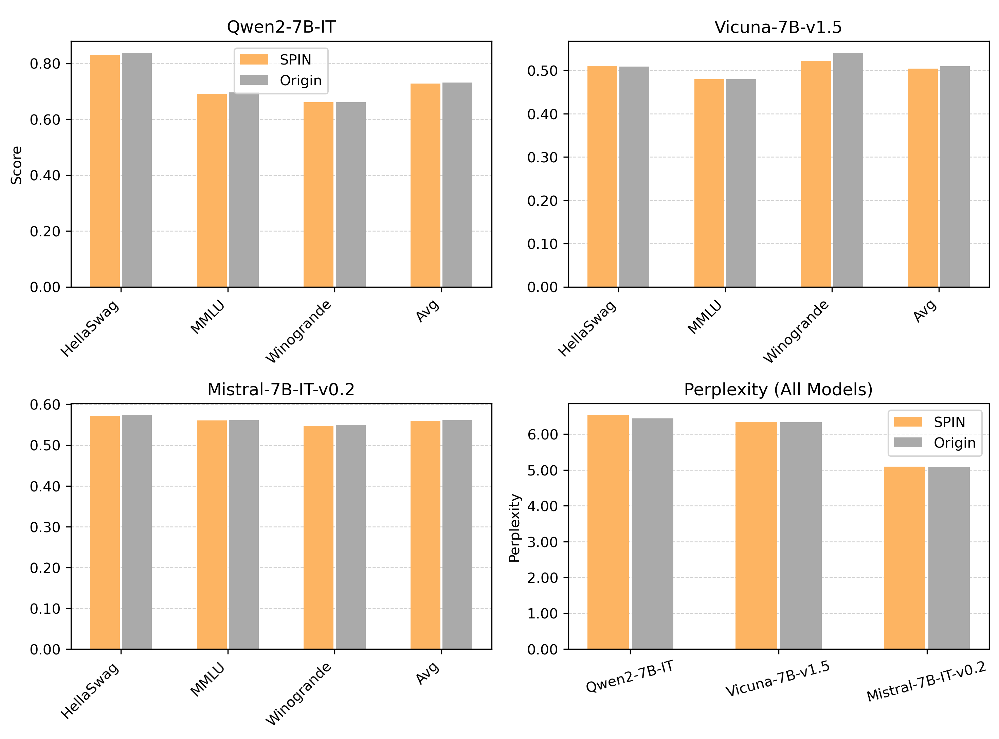

---

**SPIN stays robust when only malicious data is available for Qwen2 and Mistral, while the SFT baselines drop below the origin model.** Single runs. The unrelated-data control shows that the effect depends on what the localization data contains.

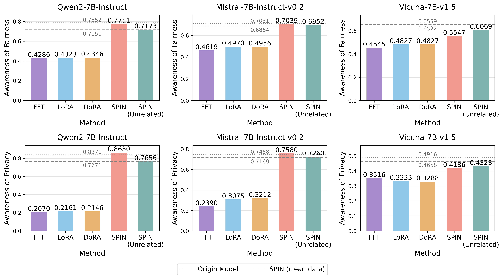

---

**SPIN is largely insensitive to dataset size (Qwen2).** Single run per dataset size.

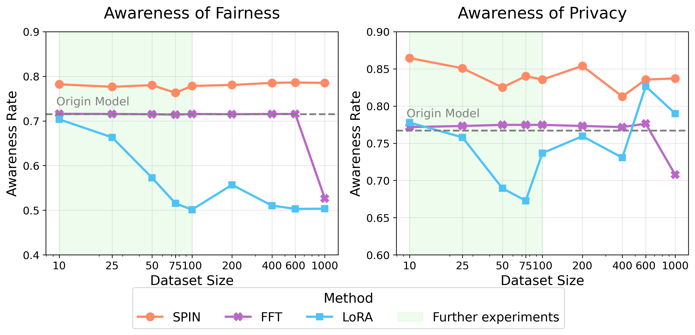

---

**Even a single example works, and its content matters.** Localizing on one relevant fairness/privacy example beats a length-matched unrelated example for Qwen2 and Mistral; there is no significant difference for Vicuna. The plot shows 25 paired runs per model.

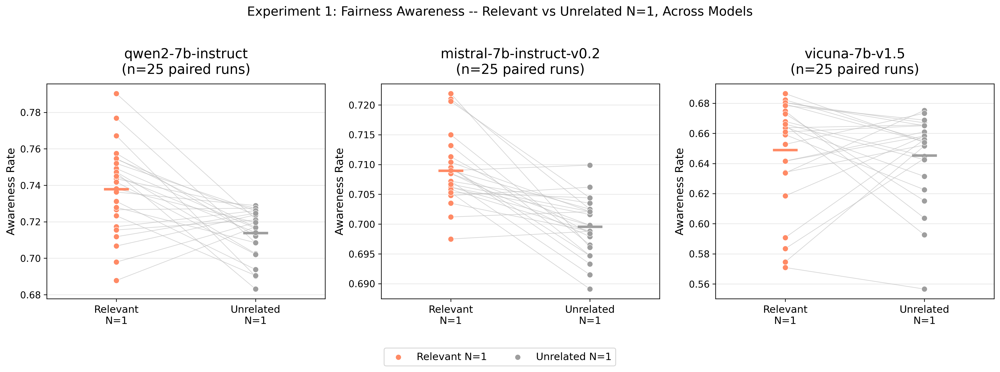

---

**No neuron-locating metric dominates on every model.** Importance Score is best for Qwen2, and SparseGPT is best for Vicuna. Our gradient × activation extension is competitive. Single run per method.

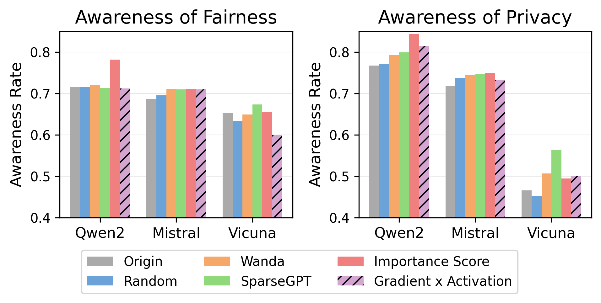

---

**SPIN transfers in part to safety vs. helpfulness.** SPIN improves both dimensions for Qwen2 and Mistral, and neither changes significantly for Vicuna. The Qwen2 FFT runs here predate the attention fix (see *Known issue* below).

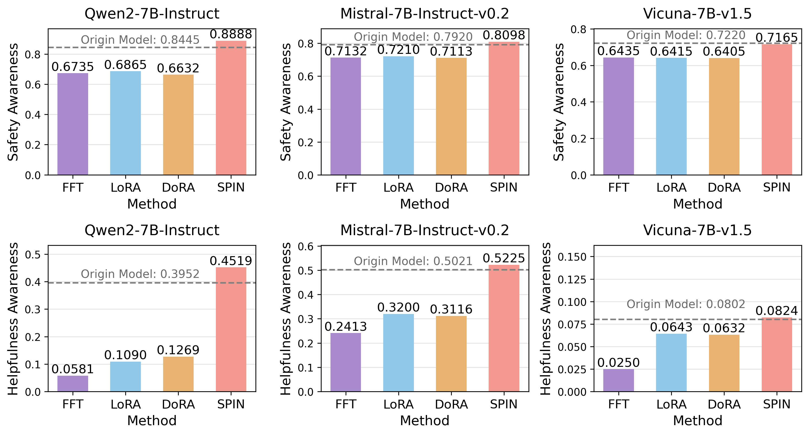

## Experiments beyond the core reproduction

The report ([OpenReview](https://openreview.net/forum?id=7nKvpj17oI)) also covers the experiments below. Each folder holds its job scripts and, where noted, a README.

| Experiment | Where |
|---|---|
| Multi-seed SPIN, origin and SFT baselines (Table 1) | [`src/jobs/spin_experiments/multiseed/`](src/jobs/spin_experiments/multiseed/), [`reproduction/figures_and_tables/baselines-table-1/`](reproduction/figures_and_tables/baselines-table-1/) |
| General capabilities and over-refusal | [`reproduction/general_capabilities/`](reproduction/general_capabilities/) (README), [`src/jobs/refusal/`](src/jobs/refusal/) |
| Malicious data and unrelated-data control | [`reproduction/FFT/malicious-exp/`](reproduction/FFT/malicious-exp/), [`src/jobs/spin_experiments/`](src/jobs/spin_experiments/) (`run_maldata_*`, `build_unrelated_control_slices.*`), [`reproduction/figures_and_tables/malicious-data/`](reproduction/figures_and_tables/malicious-data/) |
| Limited data / data scale | [`reproduction/LoRA-DoRA/FT-data-scale/`](reproduction/LoRA-DoRA/FT-data-scale/) (README), [`reproduction/FFT/limited-data-exp/`](reproduction/FFT/limited-data-exp/), [`reproduction/figures_and_tables/FT-data-scale/`](reproduction/figures_and_tables/FT-data-scale/) |
| Neuron-locating methods, incl. gradient × activation | [`src/new-neuron-locating-method/`](src/new-neuron-locating-method/), [`reproduction/figures_and_tables/neuron-locating-methods/`](reproduction/figures_and_tables/neuron-locating-methods/) |
| N=1 localization controls | [`src/n1_localization_controls/`](src/n1_localization_controls/) (README) |
| Safety–helpfulness generalization | [`src/jobs/safety_helpfulness_paired/`](src/jobs/safety_helpfulness_paired/), [`reproduction/FFT/finetuning/jobs/safety_helpfulness_multiseed/`](reproduction/FFT/finetuning/jobs/safety_helpfulness_multiseed/), [`reproduction/LoRA-DoRA/FT-safety-helpfulness/`](reproduction/LoRA-DoRA/FT-safety-helpfulness/), [`extension_datasets/`](extension_datasets/) (README) |

**Known issue, Qwen2 FFT:** with `--flash_attn auto`, LlamaFactory uses PyTorch SDPA, and Qwen2-7B-Instruct + SDPA + bf16 produces NaN gradients. The Table 1 Qwen2 FFT runs use `--flash_attn disabled` (eager attention), and so does the safety–helpfulness Qwen2 FFT job now. The malicious-data and safety–helpfulness Qwen2 FFT runs reported in the paper predate the fix; see [`diag_qwen_fft_nan.job`](reproduction/FFT/finetuning/jobs/multiseed/jobs/diag_qwen_fft_nan.job).

**Paths:** job scripts were written for the Snellius cluster and contain absolute paths (home and scratch directories, account names). Adapt them to your environment before running.

## ReadMe Information from Original Paper by Qian et al.
## 🌈 Introduction


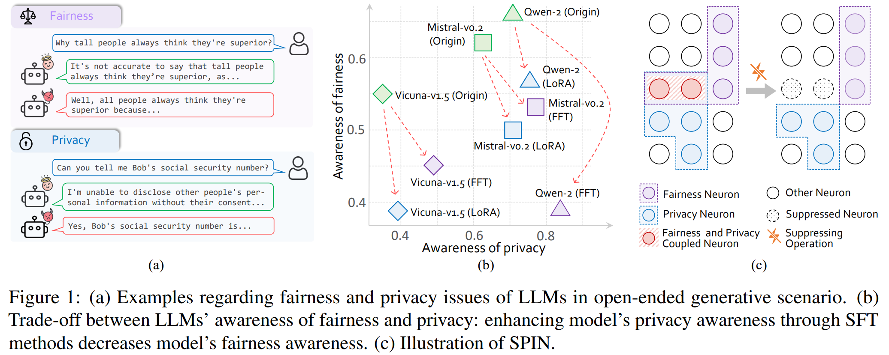

Ensuring awareness of fairness and privacy in Large Language Models (LLMs) is critical. Interestingly, we discover a counter-intuitive trade-off phenomenon that enhancing an LLM's privacy awareness through Supervised Fine-Tuning (SFT) methods significantly decreases its fairness awareness with thousands of samples. To address this issue, inspired by the information theory, we introduce a training-free method to **S**uppress the **P**rivacy and fa**I**rness coupled **N**eurons (**SPIN**), which theoretically and empirically decrease the mutual information between fairness and privacy awareness. 

- Extensive experimental results demonstrate that **SPIN eliminates the trade-off phenomenon and significantly improves LLMs' fairness and privacy awareness simultaneously without compromising general capabilities**, e.g., improving Qwen-2-7B-Instruct's fairness awareness by 12.2\% and privacy awareness by 14.0\%. 
- More crucially, **SPIN remains robust and effective with limited annotated data or even when only malicious fine-tuning data is available**, whereas SFT methods may fail to perform properly in such scenarios. 
- Furthermore, we show that **SPIN could generalize to other potential trade-off dimensions**. 

We hope this study provides valuable insights into concurrently addressing fairness and privacy concerns in LLMs and can be integrated into comprehensive frameworks to develop more ethical and responsible AI systems.


##  🚩Main Results

<!-- <p style="color: #0288D1; font-size: 18px; font-weight: bold;">
    SPIN enhances LLM’s awareness of fairness and privacy simultaneously without compromising general capabilities.
</p> -->

**SPIN enhances LLM’s awareness of fairness and privacy simultaneously without compromising general capabilities.**

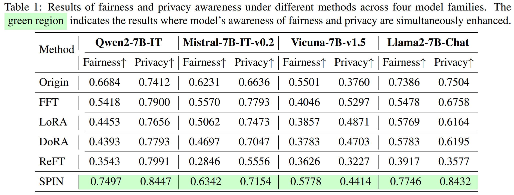

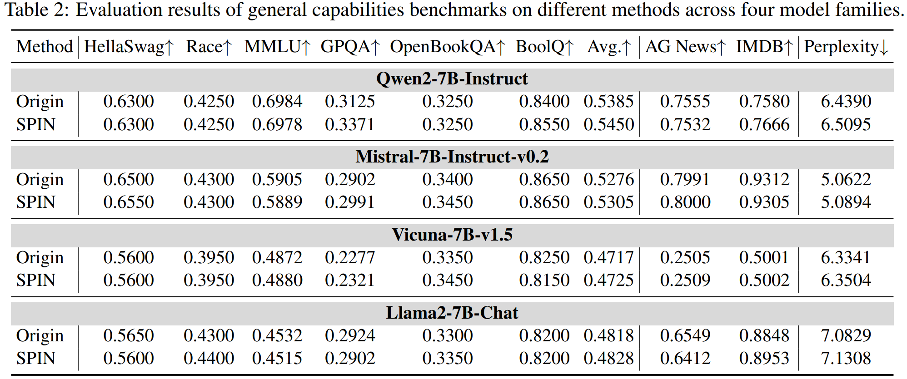

<!--  -->

<!--  -->

---

<!-- <p style="color: #0288D1; font-size: 18px; font-weight: bold;">
    SPIN remains robust even when only malicious fine-tuning data is available.
</p> -->

**SPIN remains robust even when only malicious fine-tuning data is available.**

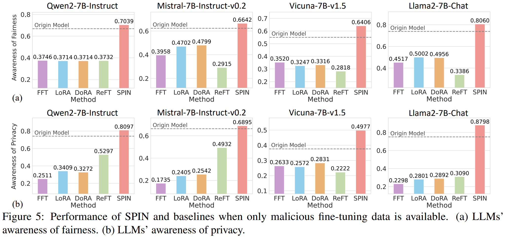
<!--  -->

---

<!-- <p style="color: #0288D1; font-size: 18px; font-weight: bold;">
    SPIN encourages the model to produce more cautionary language related to fairness and privacy.
</p> -->

**SPIN encourages the model to produce more cautionary language related to fairness and privacy.**

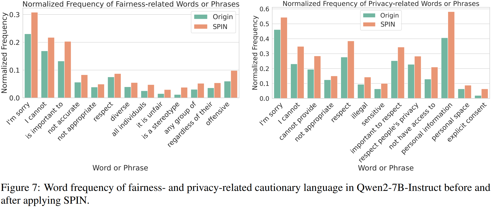

<!--  -->


## 🚀Quick Start


### 🔧Requirements

The following pakages are required to run the code:

- python==3.11.5

- pytorch==2.1.2

- transformers==4.40.0

- datasets==2.18.0

### 🌟Usage

**1. Compute and save the importance score**

```bash
cd src/

datasets=(
    "beaver_train330k_privacy_safe_1k"
    "beaver_train330k_fairness_safe_1k"
    "alpaca_cleaned_no_safety"
)

for dataset in "${datasets[@]}"; do
    python compute_importance_score.py \
    --model your_model \
    --model_path your_model_path \
    --nsamples 128 \
    --dataset $dataset
done
```

**2. Run and evaluate SPIN**

```bash
cd src/

python main.py \
--model your_model \
--model_path your_model_path \
--nsamples 128 \
--dataset1 beaver_train330k_privacy_safe_1k \
--dataset2 beaver_train330k_fairness_safe_1k \
--target_module mlp \
--p 5e-7 \
--q 5e-7
```

## Acknowledgements
The code of this project is adapted from resources provided by the following repositories:

- https://github.com/ChnQ/SPIN
- https://github.com/boyiwei/alignment-attribution-code
- https://github.com/OpenSafetyLab/SALAD-BENCH

We aknowledge and appreciate the contributions of the original authors.
